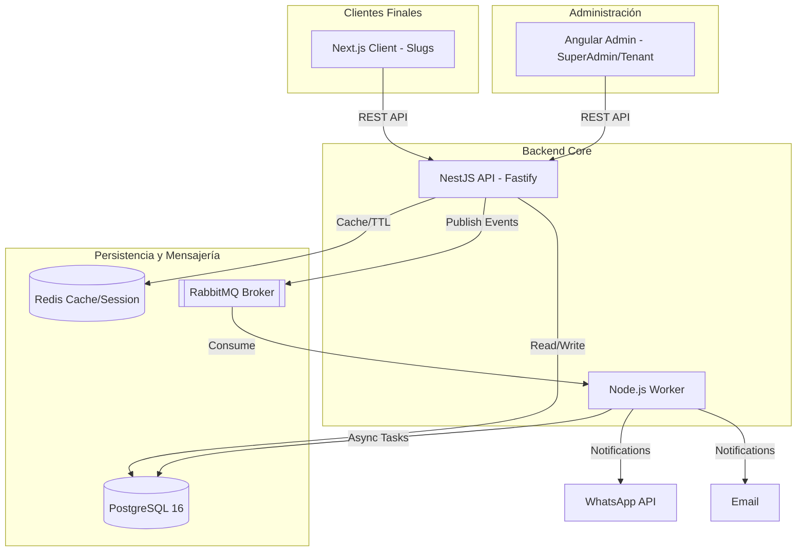

# 03 Arquitectura Técnica

# 🏗️ Diseño de Arquitectura: SaaS CGBG (v1.0)

Este documento describe la arquitectura técnica del ecosistema **CGBG**, diseñado para ser escalable, multitenant y centrado en el rendimiento.

---

## 1. Visión General del Sistema

El sistema utiliza una arquitectura de **Monorepo** basada en servicios desacoplados pero integrados mediante un Broker de Mensajería (RabbitMQ) y una Base de Datos centralizada con aislamiento lógico.

---

## 2. Arquitectura de Datos: Estrategia Multitenant

CGBG utiliza el patrón de **Shared Database, Shared Schema** con aislamiento lógico por discriminador. El esquema consta de **13 entidades principales** divididas en módulos de identidad, configuración global, gestión de negocios y operación.

### 2.1. Aislamiento por `tenantId`
Cada registro en las tablas operativas (`Branch`, `Service`, `Appointment`, `WorkSchedule`, `NonWorkingDays`, `TenantPaymentMethods`) incluye una columna `tenantId` (FK a la tabla `Tenant`).
- **Prisma Middlewares/Extensions**: Se utilizarán para interceptar consultas y asegurar que el `tenantId` esté siempre presente en los filtros `WHERE`, evitando fugas de datos entre clientes.
- **Configuración Global**: Tablas como `GlobalSettings`, `Templates` y `SubscriptionPackages` no poseen `tenantId`, ya que son administradas exclusivamente por el **SuperAdmin**.
- **JSONB para Personalización**: Las tablas `TenantConfig` y `GlobalSettings` utilizan columnas `JSONB` de PostgreSQL para almacenar configuraciones dinámicas sin alterar el esquema base.

---

## 3. Arquitectura del Backend (NestJS)

El API Core sigue los principios de **Onion Architecture** (Arquitectura de Cebolla) para garantizar que la lógica de negocio sea independiente de los frameworks y la infraestructura.

### 3.1. Capas:
1.  **Dominio (Core)**: Entidades y lógica pura de negocio (ej: validación de disponibilidad de cita).
2.  **Aplicación (Servicios)**: Casos de uso y orquestación.
3.  **Infraestructura**: Implementaciones de Prisma, RabbitMQ, Mailer.
4.  **Presentación**: Controladores de NestJS con motor **Fastify**.

---

## 4. Comunicación y Mensajería

### 4.1. Síncrona (REST)
- Utilizada para todas las operaciones de CRUD y consultas de Dashboards.
- **Fastify** se prefiere sobre Express por su superior gestión de recursos y velocidad de respuesta en entornos SaaS.

### 4.2. Asíncrona (RabbitMQ)
El sistema utiliza el patrón **Event-Driven** para procesos que no deben bloquear al usuario:
- **Flujo de Notificaciones**: Cuando se crea una cita, el API publica un evento `appointment.created`. El `cgbg-worker` consume el evento y dispara el mensaje de WhatsApp.
- **Vigencia de Pagos**: Redis almacena la vigencia de los enlaces de pago. Al expirar, se lanza un evento para liberar el slot de tiempo en la agenda.

---

## 5. Estrategias de Frontend

### 5.1. Admin Dashboard (Angular 17+)
- **Lazy Loading**: Los módulos de `SuperAdmin` y `TenantAdmin` se cargan solo cuando se necesitan.
- **Shared UI**: Una librería de componentes común para asegurar coherencia visual en todos los paneles.

### 5.2. Client Office (Next.js 14+)
- **ISR (Incremental Static Regeneration)**: Los sitios de los Tenants (`/slug`) se generan de forma estática pero se invalidan cada cierto tiempo o bajo demanda cuando el Tenant actualiza su configuración. Esto permite tiempos de carga instantáneos (Lighthouse 90+).
- **SEO Ready**: Generación de Meta Tags dinámicos basados en la configuración del Tenant.

---

## 6. Seguridad y Resiliencia

- **JWT + RBAC**: Los tokens incluyen el rol (`SUPERADMIN`, `TENANT`, `CUSTOMER`) y el `tenantId` asociado.
- **Docker Orchestration**: Cada servicio (`db`, `redis`, `mq`, `api`) corre en su propio contenedor, facilitando la escalabilidad horizontal en entornos Linux (VPS/Cloud).
- **Graceful Shutdown**: Implementado en el Backend y Worker para asegurar que no se pierdan mensajes de RabbitMQ durante despliegues.

---

### Instrucción de Diseño:
> "Cualquier nuevo componente añadido al sistema debe respetar el aislamiento por `tenantId` y preferir la comunicación asíncrona para integraciones de terceros mediante el Worker correspondente."
