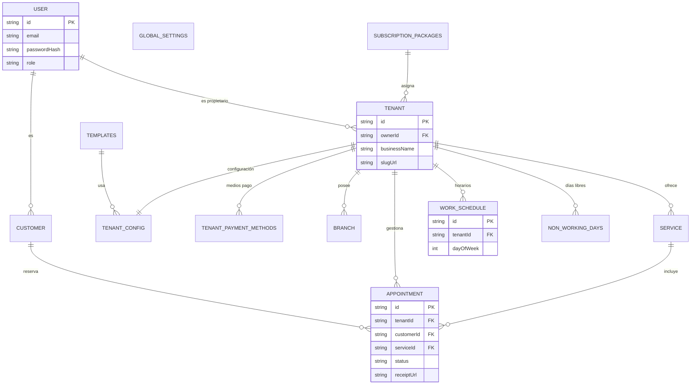

# 04 Modelo Entidad-Relación (ERD)

---
> [!IMPORTANT]
> Este diagrama incluye las **13 entidades principales** del sistema. Refleja las relaciones lógicas del monorepo y debe mantenerse alineado con el diccionario de datos en `docs/08-base-de-datos/`.
